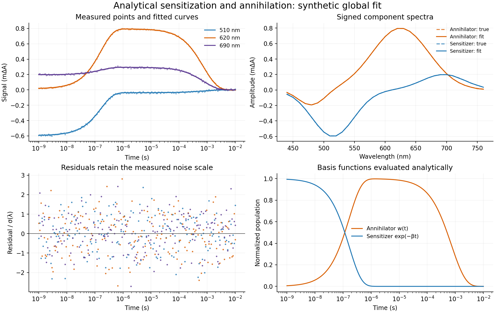

# Validation of the analytical TTA update

## Provenance and scope

This update was developed from the uploaded `phoskhemia-master.zip` whose ZIP
comment identifies commit `052add8340f7fb4a122ed6c8f48c6acaff8cb6f6`.
No remote branch or package release was changed. Validation here concerns the
supplied source plus the changes in this deliverable; it does not establish
that the model describes any particular experimental dataset.

## Executed regression suite

```bash
python -m unittest discover -s tests -v
```

**80 tests passed** in the final source-tree run recorded in
[test-results.txt](test-results.txt). Runtime was 8.645 seconds on the shared
validation host; timing is not a performance guarantee.

| Test module | Count | Main independent checks |
|---|---:|---|
| `test_analytic_kinetics` | 19 | Exact limits, Bessel comparison, ODE reference, long-time tails, time/concentration units, irregular input order, legacy/new model equivalence |
| `test_global_fit` | 15 | Recovery of known parameters and signed spectra, scalar-reference weighted optimum, augmented ridge least squares, covariance/DoF, fixed parameters and exact zeros, rank failures, backend contract |
| `test_data_invariants` | 23 | Coordinate/noise/probe alignment, NumPy return types, trim boundaries, supported means/combination, bin counts, unit-invariant default downsampling |
| `test_corrections` | 3 | Matching time/data outputs after time-zero correction and valid/error IRF helper execution |
| `test_diagnostics` | 16 | Hand-computed heterogeneous chi-square and likelihood, covariance transformations, report rendering, reconstruction, held-out amplitudes |
| `test_imports` | 4 | Original public import coverage, migrated to the standard-library runner |

The production analytical evaluator imports no ODE integrator. An end-to-end
fit test replaces `scipy.integrate.solve_ivp` with a function that raises if
called; the fit still succeeds. ODE integration is used only for independent
validation references.

## Numerical domain

For comparison, the scalar Riccati reference factors out a known exponential:

\[
w=e^{-rs}v,\quad r=\min(\nu,1),
\]

\[
v'=e^{-(1-r)s}-(\nu-r)v-\eta e^{-rs}v^2.
\]

This prevents the reference's absolute tolerance from swamping a tiny decayed
population. It is a separate computation from the production matrix-series
expression.

The dense validation sweep covers 70 combinations of

- nu: `0, 1e-12, 1/6000, 0.1, 1-1e-10, 1, 1+1e-10, 2, 10, 100`;
- eta: `0, 1e-16, 1e-8, 1e-4, 0.1, 1, 10`;
- dimensionless time: zero and logarithmically spaced values through `1e6`.

Observed maximum absolute discrepancy was about **1.7e-11 in normalized w**,
at very long times with near-zero first-order decay. At a concentration scale
`P/beta=1e-6 M`, that is about `1.7e-17 M`. The worst manual-check location
agreed across tighter DOP853, Radau, and an early-integration/exact-decay-tail
reference, confirming that it is small floating-point matrix-exponential error.

For the original physical example `P=3 M/s`, `beta=6e6/s`, `gamma=1e3/s`, and
`q` from `1e-3` through `1e10 M^-1 s^-1`, the observed concentration discrepancy
was about **5.3e-20 M or less** over 1 ns through 10 ms. No cutoff or nonfinite
values were observed in that sweep.

The default `tol=1e-14` controls the analytical series truncation bound, not
roundoff. It must not be advertised as a guarantee of `1e-14` total numerical
error. Nor do the observed finite-domain errors prove a universal bound on all
possible parameters.

The independent [validation script](../examples/validate_analytic_domain.py)
and its actual [JSON output](analytic-validation.json) record the domain,
reference tolerances, source hashes, errors, and optional timings. Reproduce
them with:

```bash
python examples/validate_analytic_domain.py --benchmark --output docs/analytic-validation.json
```

Benchmark timings depend on BLAS, SciPy, hardware, and shared-host load. In
the saved run, five-repeat medians were approximately 6.9 ms for 200 points /
55.7 ms for 1000 points at the original parameters, and 27.0 ms / 162.4 ms at
eta=10. Earlier runs on the same shared host were slower. These measure the
kinetic evaluator, not an entire fit.

## Seeded global fitting demonstration

Run from an installed checkout:

```bash
python examples/sensitized_tta_global_fit.py --plot docs/figures/tta-fit.png
```

The example contains **181 times by 33 wavelengths**, signed component
spectra, and independent Gaussian noise whose standard deviation changes with
wavelength. It fits three kinetics plus 66 amplitudes. Full local 95% intervals
and diagnostic output are stored in [example-result.json](example-result.json).

| Quantity | True value | Fitted value (rounded) |
|---|---:|---:|
| beta / s^-1 | 6,000,000 | 6,005,996 |
| gamma / s^-1 | 1,000 | 996.416 |
| eta | 8.33333e-5 | 8.42548e-5 |
| Reduced chi-square | Expected near 1 under this constructed noise model | 0.988891 |
| Residual degrees of freedom | 181*33 - (3+2*33) | 5904 |



Recovery of synthetic truth checks implementation. It is not evidence for the
physical model, independent-noise assumptions, excitation calibration, or
parameter identifiability in a specific experiment.

## Packaging and environment

Executed locally using:

- Python 3.12.14;
- NumPy 2.3.5;
- SciPy 1.17.0;
- setuptools 84.0.0.

Core source imports, an isolated extracted-wheel import/evaluation, wheel
metadata/package-data inspection, and a source-distribution build succeeded.
Builds were made with the installed setuptools backend without fetching new
dependencies. The existing license-table/classifier metadata emits a setuptools
deprecation warning; it did not prevent either build.

The uploaded project declares **Python >=3.13**. That requirement was retained.
The local 3.12 source/wheel checks do not certify the advertised supported
versions. CI is configured for 3.13 and 3.14, but was **not executed here**.

The real optional `odrpack` package was unavailable. Its callback and OLS task
contract are covered by a mock test and checked against the official API;
a real native-backend run is still required before relying on that option.
The default SciPy least-squares path was exercised end to end.

MATLAB v7.3/HDF5 orientation, optional smoothing dependencies, calibrated time
zero/IRF behavior, and arbitrary array uncertainty propagation are not covered
by a comprehensive fixture or scientific validation suite. These limits are
listed in the [repository review](repository-review.md).
